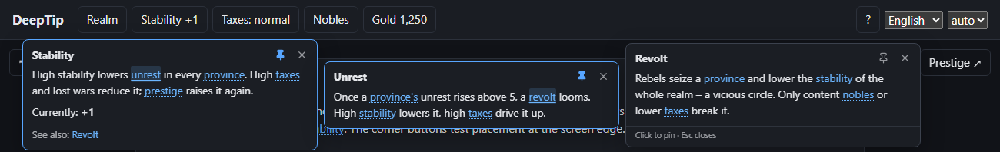

# DeepTip (Deutsch)



**DeepTip beantwortet „Was heißt das?“ genau dort, wo man gerade hinschaut.** Maus auf einem Knopf, einem Wert oder einem Wort ruhen lassen, und ein kleines Fenster erklärt es. Markierte Wörter in diesem Fenster haben eigene Erklärungen: Maus darauf, und das nächste Fenster öffnet sich daneben; ein Klick hält es fest. Man liest so tief, wie man will, und kein Fenster verdeckt das, aus dem es kam. So erklären die Strategiespiele von Paradox Interactive (Crusader Kings III, Victoria 3, Europa Universalis V) ihre Regeln; DeepTip bringt dieses Muster in jedes Programm, jedes Spiel und jedes Werkzeug, in jeder Sprache.

English: [README.md](README.md) · Downloads: [Release v1.0.0](https://github.com/gorduan/DeepTip/releases/tag/v1.0.0)

## Was es ist

| Normaler Tooltip | DeepTip |
|---|---|
| eine Zeile Text, weg, sobald sich die Maus bewegt | ein Fenster, in das man hineinfahren, lesen, festhalten und schließen kann |
| jeder Tooltip steht für sich | Begriffe darin öffnen weitere Fenster, beliebig tief |
| der Text steht im Programmcode | die Texte stehen in einer JSON-Datei je Sprache, wie Übersetzungen |
| nur Maus | Maus, Touch, Tastatur, Controller und Bildschirmleser |

- **Für Nutzer:** kein Handbuch, kein Wiki-Tab, kein Tutorial. Die Erklärung eines Begriffs ist eine Mausbewegung entfernt, und die Erklärung jedes Begriffs darin auch.
- **Für Entwickler:** ein Element mit einem Schlüssel markieren. DeepTip öffnet, platziert, verkettet, hält fest und schließt die Fenster.
- **Für Autoren und Übersetzer:** alle Texte stehen in JSON-Glossaren. Ein Eintrag hat `title`, eine Zeile `short` und einen `body` mit `[[Verweisen]]` auf andere Einträge. Ein Prüfer findet kaputte Verweise und fehlende Übersetzungen.

Passt überall, wo Nutzer vielen Begriffen begegnen, die voneinander abhängen: Spiele und Simulationen, Fachprogramme, Dashboards, Einstellungsseiten, Einstieg ohne Tutorial.

Andere Namen für dasselbe: DeepTooltip, 3DTooltip, DimTip, nested tooltips, Paradox-Tooltips, Tooltips in Tooltips, Erklärfenster.

## In das eigene Projekt einbauen

### Am einfachsten: den KI-Coding-Agenten machen lassen

Das geht für jede Sprache und jedes Framework.

1. Den DeepTip-Skill einmal installieren. Er bringt dem Agenten das ganze Muster bei und enthält jede Anleitung:

   ```bash
   git clone --depth 1 https://github.com/gorduan/DeepTip
   mkdir -p ~/.claude/skills ~/.agents/skills
   cp -r DeepTip/skill/deeptip ~/.claude/skills/   # Claude Code
   cp -r DeepTip/skill/deeptip ~/.agents/skills/   # OpenAI Codex, GitHub Copilot, Cursor, Gemini CLI
   ```

   Für claude.ai `DeepTip-skill-1.0.0.zip` aus dem Release unter *Customize → Skills* hochladen. Alle Agenten und Pfade: [skill/README.md](skill/README.md).
2. Im Projekt den Agenten bitten: *„Bau DeepTip in dieses Projekt ein und erkläre den Hauptbildschirm.“* Er erkennt das Framework, folgt dessen Anleitung, schreibt das Glossar in deiner Sprache, markiert die Elemente und prüft alles mit dem Prüfer.

### Webseite oder Web-App: drei Schritte, ohne Build

Das Beispiel in der [englischen README](README.md#a-website-or-web-app-three-steps-no-build) als Datei speichern und im Browser öffnen. Kurz:

1. `deeptip.css` und `deeptip.js` laden (vom CDN `https://cdn.jsdelivr.net/gh/gorduan/DeepTip@v1.0.0/frameworks/web/` oder die zwei Dateien aus [frameworks/web](frameworks/web) kopieren).
2. Die Erklärungen schreiben: im echten Projekt eine Datei je Sprache, `deeptip/de.json`, geladen mit `DeepTip.init({ locale: "de", sources: ["deeptip/{locale}.json"] })`.
3. Elemente mit `data-deeptip="schlüssel"` markieren. Begriffe in normalem Seitentext gehen auch (`renderText`), ein Aufruf zeigt ein Lexikon aller Einträge (`renderIndex`).

Alle Optionen: [frameworks/web/README.md](frameworks/web/README.md). React, Vue, Svelte, TypeScript, Blazor, Tauri und Electron nutzen dieselben zwei Dateien; ihre Anleitungen zeigen, wo die Aufrufe hingehören.

### Jedes andere Framework oder jede Engine

1. Das Framework in der [Tabelle](#frameworks) suchen und `DeepTip-<framework>-1.0.0.zip` aus dem [Release](https://github.com/gorduan/DeepTip/releases/tag/v1.0.0) laden oder den Ordner öffnen.
2. Web, RPG Maker MZ und Rust (egui) bringen fertigen Code mit. Für alle anderen ordnet die Anleitung jeden Teil von DeepTip Schritt für Schritt dem eigenen Toolkit zu. Mit [docs/algorithms.md](docs/algorithms.md) und den gemeinsamen Testfällen lässt sich prüfen, dass der eigene Bau sich genau wie die Referenz verhält.
3. Nicht dabei? [docs/algorithms.md](docs/algorithms.md) beschreibt jeden Ablauf ohne Programmiersprache, und der dritte Ablauf im Skill führt einen Agenten durch ein neues System.

## Erklärungen schreiben

Eine JSON-Datei je Sprache, Schlüssel mit Punkten und in jeder Sprache gleich, Text mit kleinem Markup, nie HTML: `[[schlüssel]]` und `[[schlüssel|eigener Text]]` für Verweise, `**fett**`, `*kursiv*`, `` `code` ``, `{wert}` für Live-Werte, `- ` für Listen, Leerzeile für einen Absatz. `short` bleibt eine Zeile (höchstens 140 Zeichen), `body` 2–5 Sätze. Vor jedem Release prüfen:

```bash
node tools/deeptip-check.mjs --base de deeptip/de.json deeptip/en.json --scan src
```

Das ganze Format: [SPEC.md §2](SPEC.md).

## Frameworks

Code gibt es nur in **HTML, CSS und JavaScript** (Referenz) und in **Rust**. Jedes andere Framework hat eine genaue Bauanleitung.

- **Code:** Web (Referenz), RPG Maker MZ (Plugin auf der Web-Laufzeit), Rust (egui, zweite vollständige Umsetzung).
- **Anleitung, Stufe 1:** TypeScript, Svelte, React, Vue, Blazor (alle auf der Web-Laufzeit), Avalonia, Unity, Valheim (die Mod selbst: [gorduan/Valheim_DeepTip](https://github.com/gorduan/Valheim_DeepTip)), Godot, Python (PySide6).
- **Anleitung, Stufe 2:** Java (Swing), Kotlin (Compose), C++ (Dear ImGui), C++ (Unreal Engine 5), Swift (SwiftUI), Go (Gio).

Die Tabelle mit allen Ordnern steht in der [englischen README](README.md#frameworks).

## Für KI-Agenten und Sprachmodelle

`skill/` (der Agent Skill mit Installationshinweisen für jeden Agenten), `llms.txt` (Einstieg für Sprachmodelle), `AGENTS.md` (Anweisungen für Coding-Agenten am Repo), `docs/prompt.md` (Briefing zum Einfügen in jeden Chat).

## Werkzeuge

```bash
npm test          # Referenz gegen test/cases, Skill-Kopie aktuell
npm run check     # Glossare prüfen
npm run demo      # dann http://localhost:5560/frameworks/web/example/
npm run package   # ein Zip je Framework und den Skill nach dist/
npm run skill     # skill/deeptip/references nach Änderungen an den Originalen auffrischen
```

Lizenz: MIT. Gorduan Community (GC): frei nutzen, ändern, hochladen.
