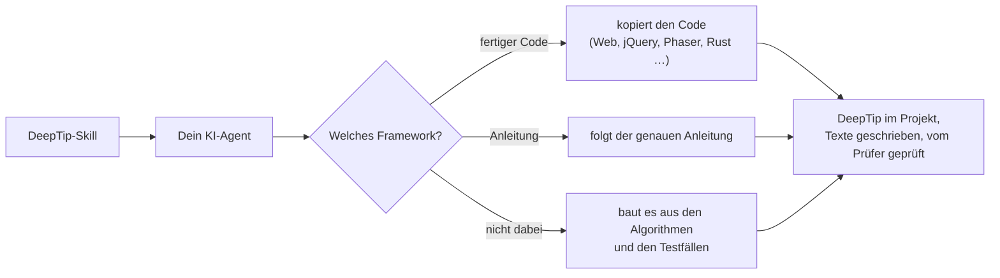

# DeepTip (Deutsch)

[](https://github.com/gorduan/DeepTip/releases) [](LICENSE) [](skill)


**DeepTip lässt jede Bedienoberfläche sich selbst erklären, so tief, wie man will.** Maus auf einem Knopf, einem Wert oder einem Wort ruhen lassen, und ein kleines Fenster erklärt es. Markierte Wörter in diesem Fenster haben eigene Erklärungen: Maus darauf, und das nächste Fenster öffnet sich daneben; ein Klick hält es fest. Das ist das System „Tooltips in Tooltips“, mit dem die Strategiespiele von Paradox Interactive (Crusader Kings III, Victoria 3, Europa Universalis V) ihre Regeln erklären, als offenes Muster für jedes Programm, jedes Spiel und jedes Werkzeug, in jeder Sprache.

English: [README.md](README.md)

## Wofür dieses Projekt da ist

Programme und Spiele sind voller Begriffe, die voneinander abhängen: Ein Wert hängt an drei anderen, eine Regel verweist auf zwei weitere. Ein normaler Tooltip zeigt eine Zeile und verschwindet; Handbuch oder Wiki sind einen Tab-Wechsel entfernt und reißen aus dem Fluss. DeepTip bringt die ganze Erklärung dorthin, wo man ohnehin hinschaut, eine Mausbewegung nach der anderen.

| Normaler Tooltip | DeepTip |
|---|---|
| eine Zeile Text, weg, sobald sich die Maus bewegt | ein Fenster, in das man hineinfahren, lesen, festhalten und schließen kann |
| jeder Tooltip steht für sich | Begriffe darin öffnen weitere Fenster, beliebig tief |
| der Text steht im Programmcode | die Texte stehen in einer JSON-Datei je Sprache, wie Übersetzungen |
| nur Maus | Maus, Touch, Tastatur, Controller und Bildschirmleser |

Gemacht für alles, wo Menschen vielen zusammenhängenden Begriffen begegnen: **Spiele und Mods** (Werte, Regeln, Gegenstände), **Fachprogramme** (Einstellungen, Einheiten, Formeln), **Dashboards** (was eine Zahl bedeutet und woher sie kommt), **Einstellungsseiten** und **Einstieg ohne Tutorial**.

Dieses Repo enthält alles, um das Muster zu nutzen:

1. **Das Muster selbst**, genau aufgeschrieben: die [Spezifikation](SPEC.md) und jeder Ablauf als sprachneutraler Pseudocode in [docs/algorithms.md](docs/algorithms.md).
2. **Fertigen Code** in HTML, CSS, JavaScript und Rust: die Web-Laufzeit mit Adaptern für jQuery, Phaser, Bootstrap und RPG Maker MZ, dazu ein Rust-Crate für egui und Ratatui.
3. **Eine genaue Bauanleitung für jedes andere Framework**, Schritt für Schritt, mit den schon gefundenen Fallen.
4. **Einen KI-Skill und einen MCP-Server**, die das alles deinem Coding-Agenten beibringen. So kommt DeepTip in jedes Projekt, auch in ein Framework ohne Anleitung.
5. **Werkzeuge:** JSON-Schema und Prüfer für die Erklärungsdateien und gemeinsame Testfälle, die beweisen, dass eine Umsetzung sich wie die Referenz verhält.

## Funktioniert mit

48 Frameworks. **Fett** = fertiger Code zum Kopieren. Die anderen haben eine genaue Schritt-für-Schritt-Anleitung. Jeder Eintrag führt zu seinem Ordner, jeder Ordner ist auch ein eigener Download im [Release](https://github.com/gorduan/DeepTip/releases).

<!-- generated:works-with -->
| Bereich | Frameworks |
|---|---|
| **Web** | **[Web (HTML + CSS + JavaScript)](frameworks/web)** (Referenz) · **[Bootstrap 5](frameworks/bootstrap)** · **[jQuery (plugin)](frameworks/jquery)** · [Angular](frameworks/angular) · [Blazor](frameworks/blazor) · [Electron](frameworks/electron) · [React](frameworks/react) · [Server-rendered HTML (WordPress, Laravel, Django, Rails, ASP.NET, static sites)](frameworks/server-html) · [Svelte](frameworks/svelte) · [Tauri 2](frameworks/tauri) · [TypeScript](frameworks/typescript) · [Vue](frameworks/vue) |
| **Desktop** | **[Rust (egui)](frameworks/rust-egui)** · [.NET MAUI](frameworks/dotnet-maui) · [Avalonia](frameworks/avalonia) · [C++ (Qt 6: Widgets and Qt Quick)](frameworks/qt) · [Python (PySide6 / Qt)](frameworks/python-pyside6) · [Windows Forms](frameworks/winforms) · [WPF](frameworks/wpf) · [C++ (Dear ImGui)](frameworks/cpp-imgui) · [Go (Gio)](frameworks/go-gio) · [GTK 4 (C, PyGObject, gtk-rs)](frameworks/gtk) · [Java (JavaFX)](frameworks/javafx) · [Java (Swing)](frameworks/java-swing) · [Kotlin (Compose Desktop)](frameworks/kotlin-compose) · [Python (Kivy)](frameworks/python-kivy) · [Python (Tkinter)](frameworks/python-tkinter) · [Swift (SwiftUI)](frameworks/swift-swiftui) |
| **Mobil** | [Android (Jetpack Compose)](frameworks/android-compose) · [Flutter](frameworks/flutter) · [iOS and iPadOS (UIKit)](frameworks/ios-uikit) · [React Native](frameworks/react-native) |
| **Spiele, Engines und Mods** | **[RPG Maker MZ (plugin)](frameworks/rpgmaker-mz)** · **[Phaser 3/4 (adapter)](frameworks/phaser)** · [Godot 4](frameworks/godot) · [Unity (uGUI + TextMeshPro)](frameworks/unity) · [Unity (UI Toolkit)](frameworks/unity-uitoolkit) · [Valheim (BepInEx mod)](frameworks/valheim) ([Quelle](https://github.com/gorduan/Valheim_DeepTip)) · [Bevy (Rust)](frameworks/bevy) · [C++ (Unreal Engine 5, Slate + UMG)](frameworks/cpp-unreal) · [GameMaker (GML)](frameworks/gamemaker) · [LÖVE (Lua)](frameworks/love2d) · [Minecraft (Fabric mod)](frameworks/minecraft-fabric) · [Ren'Py](frameworks/renpy) · [Roblox (Luau)](frameworks/roblox) |
| **Terminal** | **[Rust (Ratatui, terminal)](frameworks/rust-ratatui)** · [Go (Bubble Tea, terminal)](frameworks/go-bubbletea) · [Python (Textual, terminal)](frameworks/python-textual) |
| **Alles andere** | jede Sprache, Engine oder jedes Toolkit: Dein KI-Agent baut es mit dem Skill aus [docs/algorithms.md](docs/algorithms.md) und prüft es an den gemeinsamen Testfällen |
<!-- /generated:works-with -->

Alle Umsetzungen lesen dieselben Erklärungsdateien: Ein Glossar reicht für Web-App, Desktop-Werkzeug und Spiel.

## Überall einbauen: der DeepTip-Skill

Der [DeepTip-Skill](skill) bringt einem KI-Coding-Agenten das ganze Muster bei. Einmal installieren, dann in jedem Projekt und in jeder Sprache sagen: *„Bau DeepTip in dieses Projekt ein.“*



**Was der Agent lernt:**
- was DeepTip ist und wie es sich verhalten muss: Zeiten, Platzierung, Tastatur, Touch, Controller, Barrierefreiheit;
- das Format der Erklärungsdateien;
- drei Abläufe: DeepTip einbauen, Erklärungen schreiben und prüfen, DeepTip dort bauen, wo es keine Anleitung gibt;
- jede Framework-Anleitung und eine Abnahme-Liste.

Der Skill trägt alle Anleitungen, Spezifikation, Algorithmen, Web-Laufzeit mit Adaptern, Testfälle und Prüfer in seinem eigenen Ordner, er funktioniert also auch ohne Internet.

**Welche Agenten:** Der Skill nutzt das offene Format [Agent Skills](https://agentskills.io/specification). Das lesen **Claude Code, Claude (claude.ai und Desktop-App), OpenAI Codex, GitHub Copilot, Cursor, Gemini CLI** und die meisten anderen Coding-Agenten. Der Installer legt ihn dorthin, wo deine Agenten suchen, und ergänzt einen kurzen Verweis für Agenten mit eigenem Format (Cline, Kiro, Continue, JetBrains AI Assistant, Aider …); er kennt [45 Agenten und Assistenten](skill/harnesses/README.md):

```bash
git clone --depth 1 https://github.com/gorduan/DeepTip
node DeepTip/tools/install.mjs <projekt>                               # .agents/skills/deeptip/, von den meisten Agenten gelesen
node DeepTip/tools/install.mjs <projekt> --harness claude-code,cline   # dazu die Dateien dieser Agenten
node DeepTip/tools/install.mjs --user --harness claude-code            # in den Benutzerordner, für alle Projekte
node DeepTip/tools/install.mjs --list                                  # alle Agenten und ihre Dateien
```

Jede Datei, die er ersetzt, bleibt als `<datei>.bak` erhalten; `--dry-run` zeigt, was er tun würde. Ohne Installer den Ordner `DeepTip/skill/deeptip` nach `~/.claude/skills/` (Claude Code) oder `~/.agents/skills/` (Codex, Copilot, Cursor, Gemini CLI …) kopieren. Für claude.ai `DeepTip-skill-<Version>.zip` aus den [Releases](https://github.com/gorduan/DeepTip/releases) unter *Customize → Skills* hochladen; Chat-Assistenten und lokale Modelle bekommen ein Wissenspaket (`--harness chatgpt`, `--harness ollama` …). Alle Agenten, Ordner und Quellen: [skill/README.md](skill/README.md).

**MCP-Server:** [mcp/deeptip-mcp.mjs](mcp/deeptip-mcp.mjs) gibt jedem MCP-Client (Claude Code, Claude Desktop, Cursor, VS Code mit Copilot, Windsurf, Zed, Continue, Cline, Gemini CLI, Codex) dasselbe Wissen als Werkzeuge: die passende Anleitung für einen Projektordner, jede Anleitung, Spezifikation und Algorithmen abschnittsweise, den Prüfer und einen Eintrags-Baukasten. Er liest nur, braucht nichts außer Node 18 und startet mit `node /pfad/zu/DeepTip/mcp/deeptip-mcp.mjs`; Claude Code: `claude mcp add --transport stdio --scope user deeptip -- node /pfad/zu/DeepTip/mcp/deeptip-mcp.mjs`. Alle Clients: [mcp/README.md](mcp/README.md).

## Ohne Agenten nutzen

- **Webseite oder Web-App:** das Beispiel aus der [englischen README](README.md#a-website-or-web-app-three-steps-no-build) als Datei speichern und öffnen. Kurz:
  1. `deeptip.css` und `deeptip.js` vom CDN `https://cdn.jsdelivr.net/gh/gorduan/DeepTip@v1.0.0/frameworks/web/` laden.
  2. Die Erklärungen in `deeptip/de.json` schreiben.
  3. Elemente mit `data-deeptip="schlüssel"` markieren.

  Alle Optionen: [frameworks/web/README.md](frameworks/web/README.md).
- **Jedes andere Framework:** seinen Ordner unter [Funktioniert mit](#funktioniert-mit) öffnen oder `DeepTip-<framework>-<Version>.zip` aus den [Releases](https://github.com/gorduan/DeepTip/releases) laden. Jede Anleitung beginnt mit dem, was zu kopieren oder zu bauen ist, und endet mit einer Prüfliste.

## Erklärungen schreiben

Eine JSON-Datei je Sprache. Die Schlüssel haben Punkte und sind in jeder Sprache gleich. Der Text nutzt ein kleines Markup, nie HTML:
- `[[schlüssel]]` und `[[schlüssel|eigener Text]]` für Verweise;
- `**fett**`, `*kursiv*`, `` `code` ``;
- `{wert}` für Live-Werte;
- `- ` für Listen, eine Leerzeile für einen neuen Absatz.

`short` bleibt eine Zeile (höchstens 140 Zeichen), `body` hat 2–5 Sätze. Vor jedem Release prüfen:

```bash
node tools/deeptip-check.mjs --base de deeptip/de.json deeptip/en.json --scan src
```

Das ganze Format: [SPEC.md §2](SPEC.md). Die Tabelle aller Frameworks mit Sprache, Stufe und Art steht in der [englischen README](README.md#all-frameworks-in-detail).

## Für KI-Agenten und Sprachmodelle

- `skill/`: der Agent Skill mit Installationshinweisen für jeden Agenten.
- `skill/harnesses/`: die Dateien für 45 Agenten und Assistenten, installiert von `tools/install.mjs`.
- `mcp/`: der MCP-Server mit Anleitungen, Spezifikation, Algorithmen, Framework-Erkennung und Prüfer als Werkzeuge.
- `llms.txt`: Einstieg für Sprachmodelle.
- `AGENTS.md`: Anweisungen für Coding-Agenten am Repo.
- `docs/prompt.md`: Briefing zum Einfügen in jeden Chat.

## Werkzeuge

```bash
npm test             # Referenz gegen test/cases, MCP-Server, Installer, erzeugte Dateien aktuell
npm run check        # Glossare prüfen
npm run demo         # dann http://localhost:5560/frameworks/web/example/
npm run package      # ein Zip je Framework und den Skill nach dist/
npm run skill        # skill/deeptip/references nach Änderungen an den Originalen auffrischen
npm run frameworks   # Framework-Listen (README, SKILL.md, llms.txt) aus den Manifesten neu schreiben
npm run harness      # skill/harnesses aus skill/harnesses/source.json neu schreiben
npm run mcp          # den MCP-Server auf stdio starten
```

Lizenz: MIT. Gorduan Community (GC): frei nutzen, ändern, hochladen.
