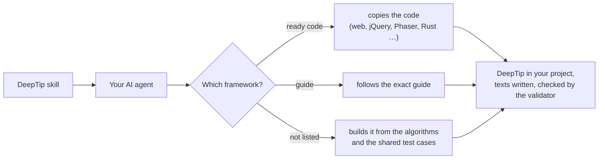

# DeepTip

[](https://github.com/gorduan/DeepTip/releases) [](LICENSE) [](skill)


**DeepTip makes any user interface explain itself, as deep as the user wants.** Rest the mouse on a button, a value or a word, and a small window explains it. Highlighted words in that window have explanations of their own: move onto one and the next window opens beside the first, click and it stays. It is the "tooltips in tooltips" system that Paradox Interactive's strategy games (Crusader Kings III, Victoria 3, Europa Universalis V) use to teach their rules, turned into an open pattern that works in any program, game or tool, in any language.

Deutsch: [README.de.md](README.de.md)

## What this project is for

Modern software and games are full of terms that depend on each other: a value depends on three other values, a rule refers to two other rules. An ordinary tooltip shows one line and disappears; a manual or a wiki is a tab switch away and breaks the flow. DeepTip puts the whole explanation where the user already looks, one hover at a time.

| An ordinary tooltip | A DeepTip |
|---|---|
| one line of text, gone as soon as the mouse moves | a window you can move into, read, pin and close |
| every tooltip stands alone | terms inside open further windows, as deep as you like |
| the text sits in the program code | the texts sit in one JSON file per language, like translations |
| mouse only | mouse, touch, keyboard, gamepad and screen readers |

It is made for anything where people meet many connected concepts: **games and mods** (stats, rules, items), **professional tools** (settings, units, formulas), **dashboards** (what a number means and where it comes from), **configuration screens** and **onboarding without tutorials**.

This repository contains everything you need to use the pattern:

1. **The pattern itself**, written down exactly: the [specification](SPEC.md) and every algorithm as language-neutral pseudo-code in [docs/algorithms.md](docs/algorithms.md).
2. **Ready-made code** in HTML, CSS, JavaScript and Rust: the web runtime with adapters for jQuery, Phaser, Bootstrap and RPG Maker MZ, and a Rust crate for egui and Ratatui.
3. **An exact build guide for every other framework**, step by step, with the pitfalls already found.
4. **An AI skill and an MCP server** that teach your coding agent all of it, so DeepTip can be added to any project, even in a framework that has no guide yet.
5. **Tools**: a JSON Schema and a validator for the explanation files, and shared test cases that prove an implementation behaves like the reference.

## Works with

48 frameworks. **Bold** = ready-made code you copy into your project. The others have an exact step-by-step guide. Each entry links to its folder; each folder is also a separate download on the [releases page](https://github.com/gorduan/DeepTip/releases).

<!-- generated:works-with -->
| Area | Frameworks |
|---|---|
| **Web** | **[Web (HTML + CSS + JavaScript)](frameworks/web)** (the reference) · **[Bootstrap 5](frameworks/bootstrap)** · **[jQuery (plugin)](frameworks/jquery)** · [Angular](frameworks/angular) · [Blazor](frameworks/blazor) · [Electron](frameworks/electron) · [React](frameworks/react) · [Server-rendered HTML (WordPress, Laravel, Django, Rails, ASP.NET, static sites)](frameworks/server-html) · [Svelte](frameworks/svelte) · [Tauri 2](frameworks/tauri) · [TypeScript](frameworks/typescript) · [Vue](frameworks/vue) |
| **Desktop** | **[Rust (egui)](frameworks/rust-egui)** · [.NET MAUI](frameworks/dotnet-maui) · [Avalonia](frameworks/avalonia) · [C++ (Qt 6: Widgets and Qt Quick)](frameworks/qt) · [Python (PySide6 / Qt)](frameworks/python-pyside6) · [Windows Forms](frameworks/winforms) · [WPF](frameworks/wpf) · [C++ (Dear ImGui)](frameworks/cpp-imgui) · [Go (Gio)](frameworks/go-gio) · [GTK 4 (C, PyGObject, gtk-rs)](frameworks/gtk) · [Java (JavaFX)](frameworks/javafx) · [Java (Swing)](frameworks/java-swing) · [Kotlin (Compose Desktop)](frameworks/kotlin-compose) · [Python (Kivy)](frameworks/python-kivy) · [Python (Tkinter)](frameworks/python-tkinter) · [Swift (SwiftUI)](frameworks/swift-swiftui) |
| **Mobile** | [Android (Jetpack Compose)](frameworks/android-compose) · [Flutter](frameworks/flutter) · [iOS and iPadOS (UIKit)](frameworks/ios-uikit) · [React Native](frameworks/react-native) |
| **Games, engines and mods** | **[RPG Maker MZ (plugin)](frameworks/rpgmaker-mz)** · **[Phaser 3/4 (adapter)](frameworks/phaser)** · [Godot 4](frameworks/godot) · [Unity (uGUI + TextMeshPro)](frameworks/unity) · [Unity (UI Toolkit)](frameworks/unity-uitoolkit) · [Valheim (BepInEx mod)](frameworks/valheim) ([source](https://github.com/gorduan/Valheim_DeepTip)) · [Bevy (Rust)](frameworks/bevy) · [C++ (Unreal Engine 5, Slate + UMG)](frameworks/cpp-unreal) · [GameMaker (GML)](frameworks/gamemaker) · [LÖVE (Lua)](frameworks/love2d) · [Minecraft (Fabric mod)](frameworks/minecraft-fabric) · [Ren'Py](frameworks/renpy) · [Roblox (Luau)](frameworks/roblox) |
| **Terminal** | **[Rust (Ratatui, terminal)](frameworks/rust-ratatui)** · [Go (Bubble Tea, terminal)](frameworks/go-bubbletea) · [Python (Textual, terminal)](frameworks/python-textual) |
| **Everything else** | any language, engine or toolkit: your AI agent builds it with the skill from [docs/algorithms.md](docs/algorithms.md) and checks it against the shared test cases |
<!-- /generated:works-with -->

Every implementation reads the same explanation files, so one glossary serves your web app, your desktop tool and your game.

## Put it anywhere: the DeepTip skill

The [DeepTip skill](skill) teaches an AI coding agent the whole pattern. Install it once, then ask your agent *"Add DeepTip to this project"* in any project, in any language.



**What the agent learns:** what DeepTip is and how it must behave (timings, placement, keyboard, touch, gamepad, accessibility), the explanation file format, three workflows (add DeepTip to a project, write and check explanations, build it where no guide exists), every framework guide and a checklist for the result. The skill carries all guides, the specification, the algorithms, the web runtime and its adapters, the test cases and the validator in its own folder, so it also works offline.

**Which agents:** the skill uses the open [Agent Skills](https://agentskills.io/specification) format, read by **Claude Code, Claude (claude.ai and the desktop app), OpenAI Codex, GitHub Copilot, Cursor, Gemini CLI** and most other coding agents. The installer puts it where your agents look and adds a short pointer for agents with their own format (Cline, Kiro, Continue, JetBrains AI Assistant, Aider …); it knows [45 agents and assistants](skill/harnesses/README.md):

```bash
git clone --depth 1 https://github.com/gorduan/DeepTip
node DeepTip/tools/install.mjs <project>                               # .agents/skills/deeptip/, read by most agents
node DeepTip/tools/install.mjs <project> --harness claude-code,cline   # plus the files of these agents
node DeepTip/tools/install.mjs --user --harness claude-code            # into your home folder, for all projects
node DeepTip/tools/install.mjs --list                                  # every agent and its files
```

It keeps every file it replaces as `<file>.bak`; `--dry-run` shows what it would do. Without the installer, copy the folder `DeepTip/skill/deeptip` to `~/.claude/skills/` (Claude Code) or `~/.agents/skills/` (Codex, Copilot, Cursor, Gemini CLI …). For claude.ai, upload `DeepTip-skill-<version>.zip` from the [releases](https://github.com/gorduan/DeepTip/releases) under *Customize → Skills*; chat assistants and local models get a knowledge pack (`--harness chatgpt`, `--harness ollama` …). Every agent, folder and source: [skill/README.md](skill/README.md).

**MCP server:** [mcp/deeptip-mcp.mjs](mcp/deeptip-mcp.mjs) gives every MCP client (Claude Code, Claude Desktop, Cursor, VS Code with Copilot, Windsurf, Zed, Continue, Cline, Gemini CLI, Codex) the same knowledge as tools: the guide for a project folder, every guide, the specification and the algorithms by section, the validator and an entry builder. It only reads, needs Node 18 and nothing else, and starts with `node /path/to/DeepTip/mcp/deeptip-mcp.mjs`; Claude Code: `claude mcp add --transport stdio --scope user deeptip -- node /path/to/DeepTip/mcp/deeptip-mcp.mjs`. Every client: [mcp/README.md](mcp/README.md).

Then, in your project: *"Add DeepTip to this project and explain the main screen."* The agent recognises the framework, follows its guide, writes the explanation files in your language, marks the elements and checks everything with the validator.

## Use it without an agent

### A website or web app: three steps, no build

Save this as a page and open it in the browser:

```html
<link rel="stylesheet" href="https://cdn.jsdelivr.net/gh/gorduan/DeepTip@v1.0.0/frameworks/web/deeptip.css" />

<button data-deeptip="shop.cart">Cart</button>

<script type="module">
  import { DeepTip } from "https://cdn.jsdelivr.net/gh/gorduan/DeepTip@v1.0.0/frameworks/web/deeptip.js";
  DeepTip.init({ locale: "en", delay: 500 }).add("en", {
    "shop.cart": {
      "title": "Cart",
      "short": "Items you are about to order.",
      "body": "Holds your items until you [[shop.checkout|check out]]. Prices include **VAT**."
    },
    "shop.checkout": {
      "title": "Checkout",
      "short": "Where you pay and choose delivery.",
      "body": "Confirms the items in your [[shop.cart]] and sends the order."
    }
  });
</script>
```

1. **Load** `deeptip.css` and `deeptip.js` (from the CDN as above, or copy the two files from [frameworks/web](frameworks/web)).
2. **Write the explanations.** In a real project they go into one file per language, `deeptip/en.json`, `deeptip/de.json`, loaded with `DeepTip.init({ locale: "en", sources: ["deeptip/{locale}.json"] })` (served by any web server).
3. **Mark the elements** with `data-deeptip="key"`. Terms in normal page text work too (`renderText`), and one call renders an encyclopedia of every entry (`renderIndex`).

Rest the mouse on the button: the cart window opens, and "check out" inside it opens the next one. Every option and the API: [frameworks/web/README.md](frameworks/web/README.md).

### Any other framework

Open its folder from [Works with](#works-with) or download `DeepTip-<framework>-<version>.zip` from the [releases](https://github.com/gorduan/DeepTip/releases). Each guide starts with what to copy or build and ends with a checklist; [docs/algorithms.md](docs/algorithms.md) and the shared test cases let you prove that your build behaves exactly like the reference.

## Write the explanations

One JSON file per language. Keys are dotted and the same in every language; texts use a small markup, never HTML.

```json
{
  "$schema": "https://raw.githubusercontent.com/gorduan/DeepTip/main/schema/deeptip.schema.json",
  "$locale": "en",
  "game.stability": {
    "title": "Stability",
    "short": "How calm your realm is, from -3 to +3.",
    "body": "High stability lowers [[game.unrest|unrest]] in every province. Currently: **{stability}**.\n\n- lost wars reduce it\n- [[game.prestige]] raises it",
    "see": ["game.revolt"]
  }
}
```

| Markup | Result |
|---|---|
| `[[key]]`, `[[key\|own text]]` | a link to another entry: hover previews it, a click pins it |
| `**bold**`, `*italic*`, `` `code` `` | emphasis and code |
| `{name}` | a live value your program fills in when the window opens |
| lines starting with `- `, a blank line | a list, a new paragraph |

Keep `short` to one line (at most 140 characters), write the `body` in 2–5 sentences and link every concept that has its own entry. Check the files before each release:

```bash
node tools/deeptip-check.mjs --base en deeptip/en.json deeptip/de.json --scan src
```

The full format: [SPEC.md §2](SPEC.md). DeepTip also ships a core glossary with its own help texts (`glossary/core/`, English and German).

## How DeepTip behaves

| Rule | Why |
|---|---|
| **One entry, three depths**: `title` (the name), `short` (one line), `body` (2–5 sentences with links). | The important part is always at the top; background sits one hover deeper. |
| **Terms are links**: every concept a text mentions can be its own entry. | Explanations nest without limit, nothing is explained twice. |
| **Nothing is lost by accident**: a window stays while the pointer moves towards it, terms crossed on the way do not replace it, and pinned windows close only on purpose. | Reading must never be a race against the mouse. |
| **Never cover the way back**: a further window opens next to the one it came from, never on top of it. | The chain stays readable. |
| **Content is data**: one JSON file per language, like translation files; code never contains explanation text. | Writers and translators work without programmers; every runtime uses the same files. |
| **Every input device is first-class**: mouse, touch, keyboard, gamepad, screen reader. | Games and tools are used with all of them. |
| **Native first**: use what the platform offers (popups, rich text, focus) before writing code. | Less code, better accessibility. |

Controls: rest the mouse to open, hover a term to preview it, click to pin; `Esc` closes the newest window, `Shift+Esc` closes all; `F1` or `?` opens the focused element's window; touch opens with a long press; gamepad Y opens, A follows, B closes. The exact behaviour, timings and placement rules: [SPEC.md](SPEC.md).

## All frameworks in detail

<!-- generated:framework-table -->
| Framework | Language | Tier | Kind | Folder |
|---|---|---|---|---|
| Web (HTML + CSS + JavaScript) | JavaScript | 1 | code, the reference | [frameworks/web](frameworks/web) |
| Bootstrap 5 | CSS | 1 | code, adapter on the web runtime | [frameworks/bootstrap](frameworks/bootstrap) |
| jQuery (plugin) | JavaScript | 1 | code, adapter on the web runtime | [frameworks/jquery](frameworks/jquery) |
| Angular | TypeScript | 1 | guide, on the web runtime | [frameworks/angular](frameworks/angular) |
| Blazor | C# | 1 | guide, on the web runtime | [frameworks/blazor](frameworks/blazor) |
| Electron | JavaScript/TypeScript | 1 | guide, on the web runtime | [frameworks/electron](frameworks/electron) |
| React | JavaScript/TypeScript | 1 | guide, on the web runtime | [frameworks/react](frameworks/react) |
| Server-rendered HTML (WordPress, Laravel, Django, Rails, ASP.NET, static sites) | HTML + any server language | 1 | guide, on the web runtime | [frameworks/server-html](frameworks/server-html) |
| Svelte | JavaScript/TypeScript | 1 | guide, on the web runtime | [frameworks/svelte](frameworks/svelte) |
| Tauri 2 | JavaScript/TypeScript | 1 | guide, on the web runtime | [frameworks/tauri](frameworks/tauri) |
| TypeScript | TypeScript | 1 | guide, on the web runtime | [frameworks/typescript](frameworks/typescript) |
| Vue | JavaScript/TypeScript | 1 | guide, on the web runtime | [frameworks/vue](frameworks/vue) |
| Rust (egui) | Rust | 2 | code, a complete implementation | [frameworks/rust-egui](frameworks/rust-egui) |
| .NET MAUI | C# | 1 | guide | [frameworks/dotnet-maui](frameworks/dotnet-maui) |
| Avalonia | C# | 1 | guide | [frameworks/avalonia](frameworks/avalonia) |
| C++ (Qt 6: Widgets and Qt Quick) | C++ | 1 | guide, on the web runtime | [frameworks/qt](frameworks/qt) |
| Python (PySide6 / Qt) | Python | 1 | guide | [frameworks/python-pyside6](frameworks/python-pyside6) |
| Windows Forms | C# | 1 | guide | [frameworks/winforms](frameworks/winforms) |
| WPF | C# | 1 | guide | [frameworks/wpf](frameworks/wpf) |
| C++ (Dear ImGui) | C++ | 2 | guide | [frameworks/cpp-imgui](frameworks/cpp-imgui) |
| Go (Gio) | Go | 2 | guide | [frameworks/go-gio](frameworks/go-gio) |
| GTK 4 (C, PyGObject, gtk-rs) | C | 2 | guide | [frameworks/gtk](frameworks/gtk) |
| Java (JavaFX) | Java | 2 | guide | [frameworks/javafx](frameworks/javafx) |
| Java (Swing) | Java | 2 | guide | [frameworks/java-swing](frameworks/java-swing) |
| Kotlin (Compose Desktop) | Kotlin | 2 | guide | [frameworks/kotlin-compose](frameworks/kotlin-compose) |
| Python (Kivy) | Python | 2 | guide | [frameworks/python-kivy](frameworks/python-kivy) |
| Python (Tkinter) | Python | 2 | guide | [frameworks/python-tkinter](frameworks/python-tkinter) |
| Swift (SwiftUI) | Swift | 2 | guide | [frameworks/swift-swiftui](frameworks/swift-swiftui) |
| Android (Jetpack Compose) | Kotlin | 1 | guide, on the Kotlin (Compose Desktop) guide | [frameworks/android-compose](frameworks/android-compose) |
| Flutter | Dart | 1 | guide | [frameworks/flutter](frameworks/flutter) |
| iOS and iPadOS (UIKit) | Swift | 2 | guide, on the Swift (SwiftUI) guide | [frameworks/ios-uikit](frameworks/ios-uikit) |
| React Native | JavaScript/TypeScript | 2 | guide, on the web runtime | [frameworks/react-native](frameworks/react-native) |
| RPG Maker MZ (plugin) | JavaScript | 1 | code, adapter on the web runtime | [frameworks/rpgmaker-mz](frameworks/rpgmaker-mz) |
| Phaser 3/4 (adapter) | JavaScript | 2 | code, adapter on the web runtime | [frameworks/phaser](frameworks/phaser) |
| Godot 4 | GDScript | 1 | guide | [frameworks/godot](frameworks/godot) |
| Unity (uGUI + TextMeshPro) | C# | 1 | guide | [frameworks/unity](frameworks/unity) |
| Unity (UI Toolkit) | C# | 1 | guide | [frameworks/unity-uitoolkit](frameworks/unity-uitoolkit) |
| Valheim (BepInEx mod) | C# | 1 | guide; source: [gorduan/Valheim_DeepTip](https://github.com/gorduan/Valheim_DeepTip) | [frameworks/valheim](frameworks/valheim) |
| Bevy (Rust) | Rust | 2 | guide, on Rust (egui) | [frameworks/bevy](frameworks/bevy) |
| C++ (Unreal Engine 5, Slate + UMG) | C++ | 2 | guide | [frameworks/cpp-unreal](frameworks/cpp-unreal) |
| GameMaker (GML) | GML | 2 | guide | [frameworks/gamemaker](frameworks/gamemaker) |
| LÖVE (Lua) | Lua | 2 | guide | [frameworks/love2d](frameworks/love2d) |
| Minecraft (Fabric mod) | Java | 2 | guide | [frameworks/minecraft-fabric](frameworks/minecraft-fabric) |
| Ren'Py | Python (Ren'Py) | 2 | guide | [frameworks/renpy](frameworks/renpy) |
| Roblox (Luau) | Luau | 2 | guide | [frameworks/roblox](frameworks/roblox) |
| Rust (Ratatui, terminal) | Rust | 2 | code, adapter on Rust (egui) | [frameworks/rust-ratatui](frameworks/rust-ratatui) |
| Go (Bubble Tea, terminal) | Go | 2 | guide | [frameworks/go-bubbletea](frameworks/go-bubbletea) |
| Python (Textual, terminal) | Python | 2 | guide | [frameworks/python-textual](frameworks/python-textual) |
<!-- /generated:framework-table -->

Every folder has a README with a Quick start at the top and a manifest `deeptip.json` (`kind`: `runtime`, `adapter` or `guide`, plus its `area` and `status`). Code folders have an example that uses the shared example glossary (`glossary/example/`) and tests against the shared cases (`test/cases/`); every guide says how to run those cases in its language. Each download `DeepTip-<framework>-<version>.zip` contains the framework folder, `SPEC.md`, `docs/algorithms.md`, the schema, the glossaries and the test cases.

## Reference

| File | Purpose |
|---|---|
| [SPEC.md](SPEC.md) | the contract, runtime-neutral: data format (§2), behaviour (§3), placement (§4), input (§5), accessibility (§6), options (§7), styling hooks (§8), porting checklist (§9) |
| [docs/algorithms.md](docs/algorithms.md) | the exact algorithms of the reference as language-neutral pseudo-code: what every guide builds on |
| [schema/deeptip.schema.json](schema/deeptip.schema.json) | JSON Schema for glossary files; reference it with `$schema` for completion in your editor |
| [tools/deeptip-check.mjs](tools/deeptip-check.mjs) | validator (Node 18+): broken links, missing translations, too long `short` lines, unused entries, keys used in code but not defined; exit code 1 on errors |
| [test/cases/](test/cases) | parity cases for the markup parser, placement and glossary flattening, shared by every runtime |
| `glossary/core/`, `glossary/example/` | the core glossary and the example glossary, English and German |
| [CONCEPT.md](CONCEPT.md) | research on the Paradox games and the decisions behind DeepTip (German) |

## For AI agents and language models

| File | For |
|---|---|
| [skill/](skill) | the Agent Skill that teaches DeepTip to any coding agent, with install notes for each agent |
| [skill/harnesses/](skill/harnesses) | the files for 45 agents and assistants (pointers in their own formats, a knowledge pack for chat assistants and local models), installed by [tools/install.mjs](tools/install.mjs) |
| [mcp/](mcp) | the MCP server: guides, specification, algorithms, framework detection and the validator as tools for any MCP client |
| [llms.txt](llms.txt) | the compact entry point for language models ([llms.txt proposal](https://llmstxt.org/)) |
| [AGENTS.md](AGENTS.md) | instructions for coding agents working on this repository ([AGENTS.md format](https://agents.md/)) |
| [docs/prompt.md](docs/prompt.md) | a one-page briefing to paste into any chat or system prompt |

## Development

```bash
npm test             # reference runtime against test/cases, MCP server, installer, generated files up to date
npm run check        # validate the core and example glossaries
npm run demo         # then http://localhost:5560/frameworks/web/example/
npm run package      # one download per framework, and the skill, into dist/
npm run skill        # refresh skill/deeptip/references after changing the originals
npm run frameworks   # rewrite the framework lists (README, SKILL.md, llms.txt) from the manifests
npm run harness      # rewrite skill/harnesses from skill/harnesses/source.json
npm run mcp          # start the MCP server on stdio
```

## License

MIT, see [LICENSE](LICENSE). Gorduan Community (GC): free for anyone to use, modify and re-upload.
